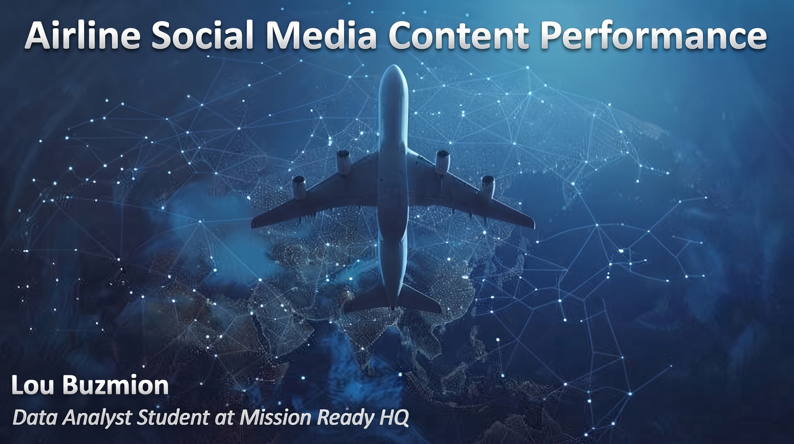

# Airline Social Media Engagement Analysis

## Project Overview

This project analyses airline social media engagement data using Microsoft Excel to identify posting patterns, content quality, user activity, and audience interactions.

The analysis focuses on understanding how customers interact with airline social media content and identifying patterns that can help improve social media engagement and communication strategies.

This project was completed as part of my Data Analytics studies.

## Dataset

- **Total records:** 27,000 posts and replies
- **Time period:** September 2015 – November 2016
- **Data source:** Provided dataset for Mission 2
- **Tools:** Microsoft Excel and Power Query

The dataset contains information about:
- Post IDs and user information
- Post creation dates and times
- Content quality ratings
- Influence scores
- Likes, comments, and shares
- Post and reply relationships

## Project Objectives

1. Identify the most active users based on post and reply counts.
2. Analyse posting patterns by day and hour.
3. Identify duplicate post IDs.
4. Investigate posts receiving more than 82 likes during 2016.
5. Analyse posting distribution across weekdays.
6. Categorise content quality and influence scores.
7. Calculate interaction and weighted interaction scores.
8. Identify the most active posting urgency category.

## Data Cleaning and Preparation

The following data preparation and transformation tasks were performed:

- Used Power Query to create a new Status column based on Influence Score.
- Classified posts with an Influence Score greater than 5.5 as High and the remaining posts as Low.
- Removed the unnecessary Story column.
- Identified duplicate PostIDs by removing airline name prefixes.
- Extracted posting dates, weekdays, and hours.
- Categorised posts into Morning, Afternoon, Evening, and Night.
- Used VLOOKUP to retrieve interaction metrics.
- Converted content quality ratings into numerical values.

## Key Findings and Analysis

### 1. Influence Score Distribution

Out of 27,000 records:

- High influence: 23,181 posts (85.86%)
- Low influence: 3,819 posts (14.14%)

Most records were classified as having high influence.

### 2. Top Seven Most Active Users

The seven users with the highest post and reply counts generated a combined total of **3,041 posts and replies**.

Qantas recorded the highest count with 1,088, followed by Jetstar Australia with 851 and Virgin Australia with 743.

### 3. Posting Activity Patterns

The highest posting activity occurred on Monday at 2:00 AM, with 464 posts and replies.

This suggests that posting activity varies considerably depending on the day and time.

### 4. Duplicate Records

The analysis identified 23 unique duplicated PostIDs after removing airline name prefixes.

This highlights the importance of standardising identifiers when combining data from multiple airline sources.

### 5. Posts with More Than 82 Likes

In 2016, six posts received more than 82 likes.

January and April recorded the highest number, with two posts each.

### 6. Posting Activity by Weekday

Saturday recorded the lowest proportion of posts and replies at 9.34%, while Monday had the highest at 17.92%.

This indicates that posting activity was generally higher during weekdays.

### 7. Content Quality Analysis

Content quality ratings were distributed across four categories:

- A: 6,727 posts
- B: 6,690 posts
- C: 6,812 posts
- D: 6,771 posts

The distribution was relatively balanced across the four categories.

### 8. Posting Urgency Analysis

Among posts classified as High:

- Night: 8,512
- Morning: 8,118
- Evening: 4,422
- Afternoon: 2,129

Night recorded the highest number of high-status posts.

### 9. Content Quality and Engagement Metrics

Additional calculations included:

- Total likes for A-rated posts: 4,541
- Average comments for B-rated posts: 1.4152
- Number of C-rated posts: 6,812

The analysis also calculated interaction scores and weighted interaction scores to evaluate engagement across individual posts.

## Tools and Excel Functions Used

**Tools:**
- Microsoft Excel
- Power Query Editor
- Pivot Tables
- Conditional Formatting
- Excel Charts

**Functions:**
- IF
- VLOOKUP
- SUMIF
- AVERAGEIF
- COUNTIF
- SUMPRODUCT

## Conclusion

This project demonstrates how Excel and data transformation techniques can be used to analyse large datasets and uncover meaningful patterns.

The analysis identified the most active users, peak posting times, duplicate records, content quality distribution, and audience engagement patterns.

The findings provide a foundation for understanding airline social media activity and identifying opportunities to improve content and engagement strategies.

## Skills Demonstrated

- Data Cleaning and Transformation
- Exploratory Data Analysis (EDA)
- Data Aggregation
- Data Validation
- Excel Formulas and Functions
- Pivot Table Analysis
- Data Visualisation
- Analytical Thinking

---

*This project was completed as part of my journey towards transitioning into a career in Data Analytics.*
